# VIKMO DealerDesk

### Enterprise Dealer Inventory, Demand Forecasting & Order Management System

[](https://www.python.org/)
[](https://www.djangoproject.com/)
[](https://react.dev/)
[](https://www.postgresql.org/)
[](https://vitejs.dev/)
[](file:///Users/sridevi/Downloads/VIKMO%20DealerDesk%20Assignment/tests)
[](file:///Users/sridevi/Downloads/VIKMO%20DealerDesk%20Assignment/frontend)

---

> ### 🚀 Live Demo & Deployment Status
> 
> **Current Hosting Status:** *Ready for Cloud Deployment* (Local Production Verified).  
> The application is currently verified and running in local production mode (`http://localhost:3000` frontend, `http://localhost:8000` Django API). A public cloud deployment requires spinning up the two services:
> - **Frontend (Vercel / Netlify):** Deploy `/frontend` with build command `npm run build` and output directory `dist`.
> - **Backend (Render / Fly.io / Railway):** Deploy the Django application with PostgreSQL managed database (e.g., Neon / Supabase / AWS RDS).
> 
> *For recruiters, interviewers, and reviewers: Follow the [Local Quickstart](#10-local-setup--installation) below to run the complete working stack with interactive frontend, backend APIs, and PostgreSQL database in under 2 minutes.*

---

## Table of Contents

1. [Executive Summary & Problem Statement](#1-executive-summary--problem-statement)
2. [UI Showcase & Application Views](#2-ui-showcase--application-views)
3. [Key Features](#3-key-features)
4. [What Makes This Project Unique](#4-what-makes-this-project-unique)
5. [Technology Stack](#5-technology-stack)
6. [System Architecture](#6-system-architecture)
7. [Machine Learning & Demand Forecasting](#7-machine-learning--demand-forecasting)
8. [API Documentation](#8-api-documentation)
9. [Database Schema & Core Business Logic](#9-database-schema--core-business-logic)
10. [Local Setup & Installation](#10-local-setup--installation)
11. [Testing & Quality Assurance](#11-testing--quality-assurance)
12. [Project Structure](#12-project-structure)
13. [Future Roadmap & Limitations](#13-future-roadmap--limitations)

---

## 1. Executive Summary & Problem Statement

**VIKMO DealerDesk** is an enterprise B2B commerce and inventory operating system built for regional automotive and two-wheeler spare parts distributors in India. The system centrally manages wholesale distribution across **25 regional dealerships** spanning a live catalogue of **600 automotive SKUs**.

### The Business Challenge
In wholesale aftermarket automotive distribution, distributors face four costly operational risks:
1. **Inventory Overselling Under Concurrency:** Multiple dealers placing simultaneous orders for scarce parts often results in negative inventory, broken supplier commitments, and expensive order cancellations.
2. **GST Inaccuracies & Financial Drift:** Statutory Indian Goods and Services Tax (GST) mandates exact 18% calculation with legal `ROUND_HALF_UP` paise precision. Inaccurate floating-point arithmetic causes off-by-one paise discrepancies across bulk orders, leading to tax reconciliation audits.
3. **Unreliable Supplier Feeds:** Supplier catalogues frequently experience network drops, rate limiting (HTTP 429), duplicate records, and invalid product pricing.
4. **Inefficient Stock Planning:** Inventory managers struggle with balancing stockout risks against holding costs across seasonal demand swings (e.g., Diwali festive surges) and highly variable lead times.

### The VIKMO Solution
VIKMO DealerDesk resolves these operational bottlenecks through:
- **Pessimistic Row-Locking Order Engine:** Guarantees zero overselling under high-concurrency race conditions using atomic database transactions with sorted SKU locking.
- **Paisa-Accurate Taxation:** Performs strict per-line decimal quantization adhering to Indian statutory tax standards.
- **Grounded AI Dealer Assistant:** Provides multi-turn, context-aware parts discovery, stock inquiries, and draft order creation grounded strictly in real-time PostgreSQL data, defended against prompt injection.
- **Leakage-Free Demand Forecasting:** Combines a 4-week machine learning forecasting model that beats historical baselines by **17.7% MAE** with Bessel-corrected safety stock calculations.
- **Monochrome Enterprise Portal:** Delivers a responsive, accessible React dashboard for catalogue browsing, live inventory adjustment, automated reorder recommendations, and order lifecycle management.

---

## 2. UI Showcase & Application Views

The frontend interface utilizes a clean, high-contrast monochrome design system (white surfaces, neutral slate borders, black typography) built with React 18 and Lucide icons.

```
┌────────────────────────────────────────────────────────────────────────────────────────┐
│  VIKMO DealerDesk  │  Catalogue & Stock  │  Reorders & Forecast  │  Orders & History  │  Assistant  │
├────────────────────────────────────────────────────────────────────────────────────────┤
│  [DLR-1001] Metro Auto Spares (ID: 1) · Mumbai           [Total Orders: 24] [Active Cart: 3]  │
└────────────────────────────────────────────────────────────────────────────────────────┘
```

### Application Workspaces

| Workspace | Component | Primary Capabilities |
|---|---|---|
| **Catalogue & Inventory Matrix** | `CatalogueView.jsx` | Paginated 600-product catalogue, multi-field search (SKU, brand, fitment), category filtering, real-time warehouse stock indicators, and inline stock adjustments with audit logging. |
| **Reorder Engine & Forecast Hub** | `ReorderDashboard.jsx` | Monitored 40 SKUs, live stock vs. reorder points, calculated safety stock, and interactive 4-week demand prediction curves. |
| **Orders & Dealer Profile Hub** | `OrderManager.jsx` | Dynamically paginated dealer selector (all 25 dealers), dealer profile card with 5 PostgreSQL-aggregated KPI metrics, itemized purchase history with historical price snapshots, date/status filtering, and order details modal. |
| **Cart & Concurrent Checkout** | `OrderManager.jsx` | Persistent dealer cart, line-item quantity controls, stock boundary validation, and one-click atomic checkout with order confirmation workflow. |
| **AI Dealer Support Assistant** | `AssistantChat.jsx` | Multi-turn conversational interface, vehicle-fitment clarification, live inventory grounding, context-aware alternatives ("this product" resolution), and draft order creation. |

### UI Screenshot Reference Guide
For documentation and deployment showcases, capture high-resolution screenshots of the 5 core views and store them in `docs/screenshots/`:

1. `docs/screenshots/01_catalogue_inventory.png` — Catalogue table with search filters and live stock badges.
2. `docs/screenshots/02_reorders_forecasting.png` — Reorder suggestions table and selected SKU 4-week forecast chart.
3. `docs/screenshots/03_orders_dealer_profile.png` — Dynamic dealer selector, 5 aggregated KPI tiles, and purchase history table.
4. `docs/screenshots/04_order_details_modal.png` — Order details modal showing itemized SKUs, quantities, and GST breakdown.
5. `docs/screenshots/05_conversational_assistant.png` — Assistant drawer showing stock check, tool citations, and alternative recommendations.

---

## 3. Key Features

### 1. Concurrency-Safe Order Engine
- **Mechanism:** When confirming orders, all target SKUs are sorted alphabetically and acquired using PostgreSQL pessimistic row locking (`SELECT ... FOR UPDATE`) within an atomic transaction.
- **Race Condition Prevention:** Even under simultaneous requests for the last physical stock unit, thread execution is serialized at the database level. The first request succeeds; subsequent requests re-read the updated stock (0) and are rejected with `409 INSUFFICIENT_STOCK`.
- **Zero Deadlocks:** Sorting SKUs prior to lock acquisition prevents circular wait conditions across multi-item orders.

### 2. Legal-Grade Indian GST Taxation
- **Paisa Precision:** Calculates 18% GST per line item using Python `Decimal` quantized with `ROUND_HALF_UP` to `0.01` (paisa).
- **Rounding Integrity:** Avoids floating-point truncation errors (`IEEE 754`) and Python default banker's rounding (`ROUND_HALF_EVEN`) to ensure exact alignment with statutory tax invoicing rules.

### 3. Leakage-Free ML Demand Forecasting
- **Horizon & Scope:** Predicts 4-week SKU demand (`2026-09-28` to `2026-10-19`) for 40 high-velocity parts (160 rows in `ml/forecast.csv`).
- **Feature Engineering:** Accounts for floating Diwali timing (`weeks_to_diwali`), historical promotional demand surges (2.22x multiplier), rare/intermittent SKU median smoothing, and exponential momentum blending for recently introduced SKUs.
- **Benchmark Performance:** Evaluated on a chronological 4-week holdout window (`2026-08-31` to `2026-09-21`) without future-data leakage, achieving **7.212 MAE** (outperforming the best baseline of 8.759 MAE by **17.7%**).

### 4. Grounded AI Dealer Assistant & Guardrails
- **Live Grounding:** Resolves product inquiries, prices, and stock counts directly from PostgreSQL via server-side function execution. Parametric model hallucination is eliminated.
- **Multi-Turn Context Resolution:** Resolves conversational references (e.g., "Show me alternatives if this product is out of stock") by tracking entity metadata across dialogue turns.
- **Structural Draft-Only Restriction:** The assistant only possesses tools to create `DRAFT` orders (`create_draft_order`). It has zero capability to confirm orders, structurally immunizing the business against malicious order placement.
- **Adversarial Injection Defense:** Neutralizes system-override prompts and unauthorized discount codes (e.g., `VIKMO-FREE-90`, `BDY-1070` admin mode overrides) embedded within untrusted supplier descriptions.
- **Multi-Provider Architecture:** Integrates with Google Gemini, OpenAI, or Groq via environment configuration, backed by a deterministic local engine that runs fully offline without external API keys.

### 5. Resilient Supplier Synchronization
- **Backoff & Rate Limiting:** Cursor-paginated ingestion client respects HTTP 429 `Retry-After` headers and applies linear backoff on 5xx transient server errors (up to 5 retries per page).
- **ISO-Timestamp Deduplication:** Resolves multi-page duplicates by comparing ISO timestamps, updating records only when incoming feeds contain fresher `updated_at` dates.
- **Atomic Rollback:** Accumulates all external pages in memory before applying changes in a single database transaction. If any page fails, the transaction rolls back cleanly, returning `502 Bad Gateway` without leaving partial records.

### 6. Orders Workspace & Dealer Analytics
- **Dynamic Dealer Pagination:** Fetches all 25 dealers across paginated DRF endpoints without hardcoded counts or limits.
- **Database-Aggregated Metrics:** Computes 5 real-time dealer metrics in PostgreSQL via a single aggregation query: Total Orders, Pending Orders, Completed Orders, Cancelled Orders, and Completed Purchase Value.
- **Historical Price Immutability:** Order line items store price snapshots at the time of purchase (`OrderItem.unit_price`), ensuring past order totals remain untouched when catalogue prices change.
- **Server-Side Authorization:** Enforces strict role and dealer scoping to prevent unauthorized cross-dealer data inspection (`HTTP 403 Forbidden`).

---

## 4. What Makes This Project Unique

| Commercial Requirement | Typical Naive Implementation | VIKMO DealerDesk Implementation |
|---|---|---|
| **Inventory Under Race Conditions** | In-memory validation followed by `product.save()`, causing overselling when 2 threads buy the last unit simultaneously. | PostgreSQL `SELECT ... FOR UPDATE` with alphabetically sorted SKUs inside `transaction.atomic()`, mathematically preventing race conditions and deadlocks. |
| **Sales Tax Calculation** | Standard Python `float(price * 0.18)` resulting in fractional paisa drift. | Exact `Decimal` arithmetic with `ROUND_HALF_UP` to `0.01` per line item, matching Indian GST statutory rules. |
| **Order Number Generation** | Random UUIDs or client-supplied IDs. | Atomic daily monotonic sequences (`ORD-YYYYMMDD-NNNN`) locked in Asia/Kolkata timezone with SHA-256 idempotency caching. |
| **AI Inventory Assistance** | Unchecked LLM answers that invent stock numbers and confirm orders based on injected instructions. | Live DB-grounded function calls, strict draft-only execution boundaries, and XML tag segregation for passive catalogue context. |
| **Demand Forecasting** | Random train/test splits that leak future sales data into past training samples. | Chronological rolling validation strictly cut off prior to the holdout window, evaluating against 3 real-world baselines. |
| **Dealer Order History** | Naive looping queries causing N+1 database hits on every page load. | Single-query PostgreSQL aggregation (`Count`, `Sum`, `Coalesce`) and `select_related` / `prefetch_related` bounds ($\le 4$ queries). |

---

## 5. Technology Stack

| Layer | Technology | Version | Purpose in Codebase |
|---|---|---|---|
| **Frontend** | React | 18.3.1 | Component-based interactive SPA architecture |
| **Frontend Tooling** | Vite | 6.1.0 | Fast HMR dev server and optimized production bundler |
| **Icons & Styling** | Lucide React / Vanilla CSS | 0.475.0 | Monochrome design system and semantic icon indicators |
| **Backend Framework** | Django | 5.2.18 | Core web framework, ORM, and transactional business logic |
| **API Layer** | Django REST Framework | 3.15.2 | RESTful serializers, pagination, and API view controllers |
| **Database** | PostgreSQL | 16.4 | ACID-compliant relational storage, row locking, and aggregation |
| **Database Driver** | Psycopg 3 (Binary) | 3.2.4 | High-performance Python PostgreSQL client with connection pooling |
| **Machine Learning** | Pandas & NumPy | 2.0+ / 1.24+ | Historical sales aggregation, feature engineering, and MAE evaluation |
| **AI Orchestration** | Gemini / OpenAI / Groq SDKs | Configurable | Conversational LLM function calling with deterministic fallback engine |
| **Testing** | Pytest & Pytest-Django | 9.1.1 / 4.8.0 | Unit, integration, concurrency race condition, and API regression testing |

---

## 6. System Architecture

```mermaid
flowchart TD
    subgraph Client["Frontend Client (React 18 + Vite)"]
        UI_Cat["Catalogue & Stock View"]
        UI_Reorder["Reorders & Forecast Dashboard"]
        UI_Order["Orders Workspace & Dealer Profile"]
        UI_Cart["Cart & Checkout Drawer"]
        UI_Chat["Dealer Assistant Chat"]
    end

    subgraph API["Django REST Framework API Gateway"]
        AuthGuard["Authorization & Scope Guard"]
        V_Cat["/api/products/ & /api/inventory/"]
        V_Order["/api/orders/ & /api/dealers/"]
        V_Cart["/api/cart/"]
        V_Sync["/api/sync/supplier/"]
        V_Assist["/api/assistant/chat/"]
        V_ML["/api/forecast/ & /api/reorder-suggestions/"]
    end

    subgraph Services["Core Business Services Layer"]
        OrderEng["order_service.py\n(Atomic Row-Locking & Sequences)"]
        GSTCalc["gst_calculator.py\n(ROUND_HALF_UP Paisa Precision)"]
        CartServ["cart_service.py\n(Dealer-Scoped Cart Management)"]
        SyncServ["sync_service.py\n(Backoff, Retries & Dedup)"]
        AssistServ["assistant_service.py\n(Intent Routing & Tool Calling)"]
        MLReorder["reorder_service.py\n(Safety Stock & Reorder Points)"]
    end

    subgraph Database["PostgreSQL 16 Database"]
        DB_Prod[(Product & InventoryLog)]
        DB_Dealer[(Dealer & Profile)]
        DB_Order[(Order & OrderItem Snapshots)]
        DB_Cart[(Cart & CartItem)]
        DB_Seq[(DailyOrderSequence & Idempotency)]
    end

    subgraph External["External Integrations & Pipelines"]
        MockSupp["Supplier Ingestion API\n(HTTP 429 / 5xx Retries)"]
        LLM["LLM Providers\n(Gemini / OpenAI / Groq / Fallback)"]
        MLPipe["train_forecast.py\n(160-Row forecast.csv)"]
    end

    %% Client to API
    UI_Cat --> V_Cat
    UI_Reorder --> V_ML
    UI_Order --> V_Order
    UI_Cart --> V_Cart
    UI_Chat --> V_Assist

    %% API to Services
    V_Cat --> OrderEng
    V_Order --> AuthGuard --> OrderEng
    V_Cart --> CartServ
    V_Sync --> SyncServ
    V_Assist --> AssistServ
    V_ML --> MLReorder

    %% Services to Helpers
    OrderEng --> GSTCalc
    CartServ --> GSTCalc
    AssistServ --> OrderEng
    AssistServ --> CartServ

    %% Services to DB
    OrderEng --> DB_Prod
    OrderEng --> DB_Order
    OrderEng --> DB_Seq
    CartServ --> DB_Cart
    V_Order --> DB_Dealer
    SyncServ --> DB_Prod

    %% External
    SyncServ <--> MockSupp
    AssistServ <--> LLM
    MLReorder <--> MLPipe
```



---

## 7. Machine Learning & Demand Forecasting

### Objective & Dataset
The forecasting pipeline predicts weekly unit demand for **40 critical automotive SKUs** across a **4-week horizon** (`2026-09-28` to `2026-10-19`), generating exactly **160 forecast records** stored in `ml/forecast.csv`.

- **Training History:** 104 historical weeks (`2024-09-30` to `2026-09-21`) across 600 catalogue products from `data/sales_history.csv`.
- **Exogenous Signals:** Promotional calendar (`data/promo_calendar.csv`), festival calendar (`data/festival_calendar.csv`), and supplier lead times (`data/lead_times.csv`).

### Feature Engineering & Domain Logic
1. **Floating Diwali Festive Lift:** Diwali shifts annually on the lunar calendar (2024: Nov 1, 2025: Oct 21, 2026: Nov 8). Rather than using static calendar months, the model engineers a dynamic `weeks_to_diwali` proximity feature. For the 2026 forecast window (-6 to -3 weeks prior to Diwali), an adjusted festive stocking coefficient is applied.
2. **Promotional Surge Multiplier:** Historical analysis revealed promotions drive an average **2.22x demand surge** (70.46 units during promotions vs. 31.80 baseline units). Scheduled promotions are incorporated directly into the forward horizon.
3. **Intermittent / Rare SKU Adjustment:** SKUs with $>50\%$ zero-sales weeks (e.g., `ELE-1006`, `GRP-1043`) utilize non-zero median sales scaled by historical purchase frequency to avoid overestimating continuous demand.
4. **New SKU Cold Start:** Recently launched parts with $<6$ weeks of history (e.g., `BRK-1105`) lack 52-week lag data. These SKUs utilize an exponential momentum blend ($0.7 \times \text{mean}_{4} + 0.3 \times \text{last}$).

### Leakage-Free Chronological Evaluation
To prevent future-data contamination, evaluation is performed strictly on a chronological 4-week holdout window (`2026-08-31` to `2026-09-21`), training only on data preceding `2026-08-24`:

```python
# ml/train_forecast.py (Lines 59-62)
train_history = sales_df[~sales_df["week_start"].isin(val_weeks)].copy()
val_actuals = sales_df[sales_df["week_start"].isin(val_weeks)].copy()
```

### Benchmark Comparison (Holdout Validation MAE)

| Model / Baseline | Holdout MAE | Error Reduction vs. Best Baseline | Status |
|---|---|---|---|
| **Last Value Baseline** (Previous week demand) | 11.725 | — | Baseline 1 |
| **Recent 4-Week Rolling Average** | 8.759 | Reference Baseline | Baseline 2 (Best) |
| **Same Week Last Year** (52-week lag) | 12.269 | — | Baseline 3 |
| **VIKMO Unified Forecasting Model** | **7.212** | **-17.7% lower error** | **Implemented** |

### Automated Reorder Math
Forecasted weekly demand feeds directly into safety stock and inventory reordering:
- **Sample Standard Deviation ($\sigma$):** Calculated with Bessel's correction (`ddof=1`): $\sigma = \sqrt{\frac{1}{n-1}\sum_{i=1}^n (x_i - \bar{x})^2}$.
- **Lead Time Demand ($D_L$):** $\text{lead\_time\_weeks} \times \bar{d}$.
- **Safety Stock ($SS$):** $\lceil 1.65 \times \sigma \times \sqrt{L} \rceil$ (95% service level factor $Z=1.65$).
- **Reorder Point ($ROP$):** $\text{lead\_time\_demand} + \text{safety\_stock}$.
- **Suggested Order Quantity:** $\max(0, \lceil ROP - \text{current\_stock} \rceil)$.

---

## 8. API Documentation

All endpoints are served under `/api/` and return standard JSON payloads.

| Method | Endpoint | Description | Key Query / Path Parameters |
|---|---|---|---|
| `GET` | `/api/health/` | System health check | — |
| `GET` | `/api/products/` | Paginated product catalogue | `?page=1&page_size=20&search=brake&category=Brakes` |
| `GET` | `/api/products/{sku}/` | Single product details | `sku` (e.g., `BRK-1044`) |
| `PATCH` | `/api/products/{sku}/` | Update product attributes | `sku`, payload with updated fields |
| `PUT` | `/api/inventory/{sku}/` | Update warehouse stock level | `sku`, body: `{"stock": 150, "reason": "Restocked"}` |
| `GET` | `/api/dealers/` | Paginated dealer directory | `?page=1&page_size=20&search=metro` |
| `GET` | `/api/dealers/{id}/` | Dealer profile with 5 aggregate KPI metrics | `id` (e.g., `1`) |
| `GET` | `/api/orders/` | List orders (scoped to authorized dealer) | `?dealer_id=1&status=CONFIRMED&start_date=2026-09-01` |
| `POST` | `/api/orders/` | Create a DRAFT order | Headers: `Idempotency-Key`, body with items |
| `GET` | `/api/orders/{order_number}/` | Inspect order details and line items | `order_number` (e.g., `ORD-20261013-0001`) |
| `PUT` | `/api/orders/{order_number}/` | Replace items in a DRAFT order | `order_number`, body: `{"items": [...]}` |
| `POST` | `/api/orders/{order_number}/confirm/` | Confirm order with atomic stock deduction | `order_number` |
| `POST` | `/api/orders/{order_number}/cancel/` | Cancel order (restores confirmed stock) | `order_number` |
| `POST` | `/api/orders/{order_number}/dispatch/`| Advance order to `DISPATCHED` | `order_number` |
| `POST` | `/api/orders/{order_number}/deliver/` | Advance order to `DELIVERED` | `order_number` |
| `GET` | `/api/cart/` | Fetch active dealer cart & totals | `?dealer_id=1` |
| `POST` | `/api/cart/items/` | Add product to cart | Body: `{"dealer_id": 1, "sku": "BRK-1044", "quantity": 5}` |
| `PUT` | `/api/cart/items/{sku}/` | Update cart item quantity | `sku`, body: `{"dealer_id": 1, "quantity": 10}` |
| `DELETE`| `/api/cart/items/{sku}/` | Remove item from cart | `sku`, `?dealer_id=1` |
| `POST` | `/api/cart/checkout/` | Checkout cart into confirmed/draft order | Body: `{"dealer_id": 1, "auto_confirm": true}` |
| `POST` | `/api/sync/supplier/` | Trigger supplier sync with retry/backoff | — |
| `POST` | `/api/assistant/chat/` | Conversational assistant turn | Body: `{"session_id": "s1", "dealer_id": 1, "message": "..."}` |
| `GET` | `/api/forecast/{sku}/` | 4-week demand predictions for SKU | `sku` (e.g., `FIL-1016`) |
| `GET` | `/api/reorder-suggestions/` | Reorder suggestions for 40 SKUs | — |

---

## 9. Database Schema & Core Business Logic

### Relational Entity Model (PostgreSQL)

```
┌─────────────────────┐            ┌─────────────────────────┐
│       Dealer        │ 1        * │          Order          │
├─────────────────────┤────────────├─────────────────────────┤
│ id (PK)             │            │ id (PK)                 │
│ dealer_code (UQ)    │            │ order_number (UQ, IST)  │
│ name                │            │ dealer_id (FK, PROTECT) │
│ city, phone, email  │            │ status (STATE_MACHINE)  │
│ credit_limit        │            │ subtotal, tax_total     │
└─────────────────────┘            │ grand_total             │
                                   └────────────┬────────────┘
                                                │ 1
                                                │ *
┌─────────────────────┐ 1        * ┌────────────┴────────────┐
│       Product       │────────────│        OrderItem        │
├─────────────────────┤            ├─────────────────────────┤
│ id (PK)             │            │ id (PK)                 │
│ sku (UQ, Index)     │            │ order_id (FK, CASCADE)  │
│ name, category      │            │ product_id (FK, PROTECT)│
│ brand, fitment      │            │ sku (Snapshot)          │
│ price (Decimal)     │            │ unit_price (Locked)     │
│ stock (Integer >= 0)│            │ quantity                │
└─────────────────────┘            │ line_subtotal, line_tax │
                                   │ line_total              │
                                   └─────────────────────────┘
```

### Critical Business Rules
1. **Foreign Key Integrity (`on_delete=models.PROTECT`):** Orders cannot be deleted if attached to a dealer, and products cannot be deleted if referenced in historical order items. This guarantees unbroken financial audit trails.
2. **Order Lifecycle State Machine:**
   - Valid forward flow: `DRAFT` $\to$ `CONFIRMED` $\to$ `DISPATCHED` $\to$ `DELIVERED`.
   - Cancellation: `DRAFT` $\to$ `CANCELLED` (no stock effect) or `CONFIRMED` $\to$ `CANCELLED` (restores stock once).
   - Invariant: A cancelled order cannot transition to any other status.
3. **Idempotent Seeding:** `python manage.py seed_data` safely seeds 600 products and 25 dealers using `update_or_create`. Running it repeatedly creates zero duplicate records.

---

## 10. Local Setup & Installation

### Prerequisites
- **Python:** 3.12+
- **Node.js:** 20+ (with npm)
- **PostgreSQL:** 16+ running locally on port 5432 (or via Docker)

---

### Step 1: Clone Repository
```bash
git clone https://github.com/sridevivg/VIKMO-DealerDesk.git
cd VIKMO-DealerDesk
```

---

### Step 2: Database Setup (PostgreSQL)
Ensure PostgreSQL is active. You can start the included PostgreSQL 16 Docker container:
```bash
docker compose up -d
```
Alternatively, create the database manually via `psql`:
```sql
CREATE DATABASE dealerdesk;
```

---

### Step 3: Backend Setup
```bash
# 1. Create and activate virtual environment
python3.12 -m venv .venv
source .venv/bin/activate

# 2. Install backend dependencies
pip install -r requirements.txt

# 3. Configure environment variables
cp .env.example .env
# Edit .env if your PostgreSQL credentials differ from localhost:5432/dealerdesk

# 4. Run database migrations
python manage.py migrate

# 5. Seed initial catalogue (600 products, 25 dealers)
python manage.py seed_data

# 6. Start Django backend server
python manage.py runserver 0.0.0.0:8000
```
Backend API will be accessible at: `http://localhost:8000/api/health/`

---

### Step 4: Frontend Setup
In a new terminal window:
```bash
cd frontend

# 1. Install dependencies
npm install

# 2. Start Vite development server
npm run dev
```
Interactive UI will be accessible at: `http://localhost:3000`

---

## 11. Testing & Quality Assurance

The codebase includes comprehensive test suites spanning unit tests, integration tests, multi-threaded race condition stress tests, and automated build checks.

### Automated Pytest Suite (66 / 66 Passing)
Run the full test suite inside the active virtual environment:
```bash
pytest
```
**Coverage breakdown:**
- `tests/test_order_concurrency.py`: Multi-threaded race condition test validating zero overselling under simultaneous confirmations.
- `tests/test_gst_calculations.py`: Exact 18% GST calculation, paisa rounding, and `ROUND_HALF_UP` boundary tests.
- `tests/test_dealer_purchase_history.py`: Profile fields, database-aggregated metrics, price immutability, date/status filtering, unauthorized cross-dealer 403 enforcement, and N+1 query limits ($\le 4$ queries).
- `tests/test_dealers_pagination.py`: Dynamic dealer pagination verifying all 25 dealers are retrieved across pages.
- `tests/test_cart_workflow.py`: Add-to-cart, quantity adjustments, stock boundaries, and checkout transitions.
- `tests/test_context_alternatives.py`: Context-aware conversational entity resolution and alternative product recommendations.
- `tests/test_assistant.py` & `tests/test_smart_assistant.py`: Prompt-injection defense, ambiguity clarification, and intent routing.
- `tests/test_supplier_sync.py`: Feed price validation, timestamp ordering, stock preservation, and retry backoff.
- `tests/test_reorder_math.py`: Bessel-corrected standard deviation (`ddof=1`), safety stock, and reorder point formulas.

---

### Frontend Production Build
Run the Vite production bundler from `frontend/`:
```bash
cd frontend && npm run build
```
- **Result:** `✓ built in ~580ms` (0 errors, 0 warnings).

---

### Official Smoke Test Suite
To verify the complete grading contract against a freshly seeded database:
```bash
# Terminal 1: Start Supplier Mock
python supplier_mock/mock_supplier.py --calm

# Terminal 2: Start Django Server
python manage.py flush --noinput && python manage.py seed_data
python manage.py runserver 0.0.0.0:8000 --noreload

# Terminal 3: Run official smoke test
python smoke_test.py --base-url http://localhost:8000 --all
```
- **Result:** `12/12 checks passed.`

---

## 12. Project Structure

```
VIKMO-DealerDesk/
├── core/                           # Primary Django application
│   ├── management/commands/        # Seed command (seed_data.py)
│   ├── migrations/                 # PostgreSQL migrations (0001, 0002)
│   ├── services/                   # Modular service architecture
│   │   ├── assistant_service.py    # LLM agent, intent routing, prompt injection defense
│   │   ├── cart_service.py         # Dealer cart management & stock validation
│   │   ├── gst_calculator.py       # Exact 18% GST decimal math (ROUND_HALF_UP)
│   │   ├── order_service.py        # Concurrency-safe order engine (SELECT FOR UPDATE)
│   │   ├── reorder_service.py      # Bessel-corrected safety stock calculations
│   │   └── sync_service.py         # Supplier sync client with backoff & deduplication
│   ├── models.py                   # Product, Dealer, Order, OrderItem, Cart, CartItem
│   ├── serializers.py              # DRF serializers with price formatting
│   ├── views.py                    # REST API endpoints & server-side authorization
│   └── urls.py                     # API routing table (/api/...)
├── data/                           # Canonical dataset CSV files
│   ├── catalogue.csv               # 600 catalogue products
│   ├── dealers.csv                 # 25 regional dealers
│   ├── sales_history.csv           # 104 weeks sales history
│   ├── festival_calendar.csv       # Annual Diwali dates
│   ├── promo_calendar.csv          # Promotion schedules
│   └── lead_times.csv              # Supplier lead times per SKU
├── dealerdesk/                     # Django project configuration (settings.py, urls.py)
├── docs/                           # Architecture audits & technical documentation
│   ├── ASSIGNMENT_ANALYSIS.md      # Deep-dive functional requirement analysis
│   └── FINAL_VERIFICATION.md       # Independent audit report & citations
├── frontend/                       # React 18 SPA (Vite)
│   ├── src/
│   │   ├── components/
│   │   │   ├── AssistantChat.jsx   # Natural-language support assistant drawer
│   │   │   ├── CatalogueView.jsx   # Product catalogue & live warehouse inventory
│   │   │   ├── OrderManager.jsx    # Orders workspace, dealer profile & cart
│   │   │   └── ReorderDashboard.jsx# Reorders & 4-week demand forecast charts
│   │   ├── services/
│   │   │   └── dealerService.js    # Dynamic multi-page dealer pagination client
│   │   ├── App.jsx                 # Main layout & tab orchestration
│   │   └── index.css               # Monochrome enterprise design tokens
│   ├── package.json
│   └── vite.config.js
├── ml/                             # Machine learning demand forecasting
│   ├── forecast.csv                # 160 generated forecast rows (40 SKUs x 4 weeks)
│   └── train_forecast.py           # Leakage-free training & baseline evaluation script
├── supplier_mock/                  # Mock supplier service for ingestion testing
│   └── mock_supplier.py
├── tests/                          # Automated Pytest test suite (66 tests)
├── docker-compose.yml              # PostgreSQL 16 container definition
├── requirements.txt                # Fixed backend Python dependencies
├── smoke_test.py                   # Smoke test validation runner
├── DECISIONS.md                    # Detailed architectural defenses & line citations
└── README.md                       # Comprehensive project documentation
```

---

## 13. Future Roadmap & Limitations

While the current system implements all requirements and passes all automated tests, the following enhancements are planned for cloud production scaling:

1. **Distributed Caching & Asynchronous Ingestion:**
   - Migrate in-memory assistant dialogue state (`SESSION_CACHE`) to Redis with TTL expiration.
   - Offload the multi-page supplier sync ingestion pipeline to Celery background workers with webhook status notifications.
2. **Dense Vector Search for Parts Discovery:**
   - Supplement SQL token filtering with dense semantic embeddings (e.g., PostgreSQL `pgvector`) to enhance synonym matching for informal workshop terminology.
3. **Probabilistic Demand Quantiles:**
   - Upgrade point forecasting to quantile LightGBM models ($P_{10}, P_{50}, P_{90}$) to dynamically calculate safety stock bands during high-volatility festival periods.
4. **Cloud Infrastructure Deployment:**
   - Deploy frontend SPA to Vercel with CDN caching.
   - Containerize Django API on AWS ECS / Render with managed RDS PostgreSQL.

---

## 14. License & Credits

Developed as part of the **VIKMO DealerDesk Assignment**. Designed and implemented following enterprise software engineering, database concurrency, and leakage-free machine learning standards.
